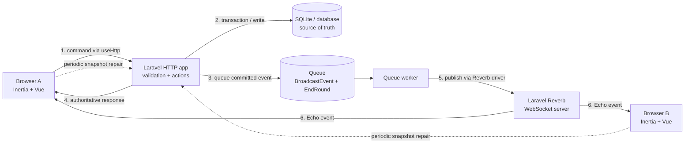

# Realtime in Scribble Relay

This is a code-guided introduction to the realtime architecture in this repository. It assumes strong general engineering experience, but no prior Laravel broadcasting, Reverb, or Echo experience.

The central idea is:

> HTTP owns commands and persistence. WebSockets distribute facts that have already been accepted by the server.

That distinction explains most of the implementation. A drawing stroke, guess, or game transition is never trusted merely because it arrived over a socket. The browser sends an ordinary authenticated HTTP request, Laravel validates and persists it, a queued broadcast publishes the resulting fact, and Echo applies that fact in the other browsers.

## Suggested learning path

1. Read this page for the system model and vocabulary.
2. Follow [Implementation walkthroughs](implementation-walkthroughs.md) while opening the linked source files.
3. Use [Reference and labs](reference-and-labs.md) to run the system, inspect the protocol, and deliberately break individual layers.
4. Return to the event catalog when changing realtime behavior.

## The system in one picture



There are four independently important runtime pieces:

| Piece                    | Responsibility                                                               | Failure symptom                                                         |
| ------------------------ | ---------------------------------------------------------------------------- | ----------------------------------------------------------------------- |
| Laravel HTTP application | authenticates commands, enforces game rules, writes canonical state          | requests fail or no state is persisted                                  |
| queue worker             | executes delayed round jobs and queued `BroadcastEvent` jobs                 | HTTP succeeds, but peers do not update; rounds do not advance           |
| Reverb                   | holds WebSocket connections and fans messages out                            | Echo shows disconnected/failed; queued broadcasts cannot reach clients  |
| Vue + Echo client        | subscribes, renders optimistic changes, consumes facts, reconciles snapshots | one browser is stale or UI state is wrong despite healthy backend state |

Reverb is not a queue and Echo is not a database. Reverb transports messages; Echo is the browser API over that transport.

## Package roles

| Package             | Role in this repository                                                                                 |
| ------------------- | ------------------------------------------------------------------------------------------------------- |
| `laravel/framework` | event dispatching, broadcasting contracts, channel authorization route, queues, HTTP/session middleware |
| `laravel/reverb`    | self-hosted Pusher-compatible WebSocket server and server-side broadcast destination                    |
| `laravel-echo`      | generic JavaScript channel/subscription API and Reverb connector                                        |
| `@laravel/echo-vue` | Vue composables, shared subscriptions, lifecycle cleanup, connection status, sensible Vite defaults     |
| `pusher-js`         | wire-protocol client used by Echo for Reverb's Pusher-compatible protocol                               |
| Inertia v3 + Vue    | initial server state, standalone `useHttp` commands, component lifecycle, rendering                     |
| Laravel queue       | asynchronous broadcasts and delayed `EndRound` execution                                                |

See [composer.json](../../composer.json), [package.json](../../package.json), and [resources/js/app.ts](../../resources/js/app.ts).

## Vocabulary mapped to this codebase

**Broadcast event**

A PHP event implementing `ShouldBroadcast`. Laravel wraps it in a queued `BroadcastEvent`; a worker later calls the configured broadcaster. Examples live in [app/Events](../../app/Events).

**Channel**

A logical topic. Every active game event uses `game.{database-id}`. It is not the public six-character route code.

**Presence channel**

A private, authorized channel that also tracks membership. Echo asks for `game.42`; the Pusher protocol uses the wire name `presence-game.42`. Authorization returns player identity data, so clients receive `here`, `joining`, and `leaving` callbacks.

**Reverb application credentials**

`REVERB_APP_ID`, `REVERB_APP_KEY`, and `REVERB_APP_SECRET` identify this Laravel application to Reverb. The key is exposed to the browser; the secret must never be exposed through a `VITE_` variable.

**Snapshot**

The complete player-specific view of current game state produced by [GameSnapshot.php](../../app/Actions/Games/GameSnapshot.php). It is used for initial Inertia props, command responses, and periodic repair.

**Optimistic/local echo**

The initiating browser updates immediately from local input or the HTTP response instead of waiting for its own queued WebSocket event. Duplicate delivery is handled explicitly.

## Why presence instead of public or private channels?

The room needs both access control and online-player awareness:

- a public channel would reveal room traffic to anyone who knows or guesses the numeric game ID;
- a private channel would authorize access, but would not provide the membership roster;
- a presence channel provides both.

The authorization path is intentionally unusual because players are guests, not normal `User` records. A random player token is stored in the session. [AuthenticateGameBroadcast.php](../../app/Http/Middleware/AuthenticateGameBroadcast.php) resolves that token to a `Player` and installs it as the request user. [routes/channels.php](../../routes/channels.php) then verifies that the player belongs to the requested game and returns only the public presence identity:

```php
[
    'id' => $player->id,
    'name' => $player->name,
]
```

Returning an array matters: a presence authorization callback must return member data, not merely `true`.

## Why HTTP and WebSockets are combined

WebSockets are excellent for low-latency distribution, but this application still needs:

- session authentication;
- validation and rate limiting;
- transactional score updates;
- row locks for concurrent guesses and round transitions;
- persistent drawings and chat history;
- recovery after a disconnect;
- normal JSON error responses.

Those concerns already fit Laravel's HTTP pipeline. The socket is therefore an invalidation and replication mechanism, not a second command API.

This creates a useful state hierarchy:

1. The database is canonical.
2. `GameSnapshot` is the canonical client projection.
3. broadcast events are incremental hints/facts that reduce latency.
4. local optimistic state hides queue and network latency.
5. the 15-second snapshot refresh repairs drift.

## The three timing models

The application mixes three timing models on purpose.

### Immediate local rendering

The drawer paints directly to the canvas during pointer movement. A guesser appends the message returned by the HTTP request. Neither user waits for the queue and WebSocket round trip.

### Asynchronous peer delivery

Active events implement `ShouldBroadcast`, so the HTTP response is not blocked by the Reverb publish. The queue worker sends the event after persistence.

### Periodic convergence

[Room.vue](../../resources/js/pages/Games/Room.vue) requests a full snapshot every 15 seconds. This covers reconnect gaps, a missed event, benign reordering, or a state-changing event received while another snapshot request is already running.

This is a pragmatic realtime design: fast in the common case and eventually self-healing.

## The two queues hiding behind “the queue”

The default `.env.example` uses the database queue. It carries two different workloads:

1. each `ShouldBroadcast` event becomes a Laravel `BroadcastEvent` job;
2. each round schedules a delayed [EndRound.php](../../app/Jobs/EndRound.php) job.

If the worker stops, peer updates and the authoritative round lifecycle both stop. A browser countdown may reach zero, but the database does not advance until `EndRound` runs or all eligible players guess correctly and `FinishRound` is called synchronously.

## Security and consistency boundaries

The implementation defends the same boundary in several places:

- the session token resolves the current player for HTTP commands and broadcast authorization;
- channel authorization checks the numeric game ID;
- actions confirm the game is playing, the round is current, and the actor has the correct role;
- request objects constrain payload shape and size;
- transactions and `lockForUpdate()` serialize score and lifecycle changes;
- `ShouldDispatchAfterCommit` prevents a queued broadcast from observing rolled-back or not-yet-visible data;
- `broadcastWith()` explicitly allowlists public payload fields and avoids leaking the secret word;
- stale drawing/guess requests carry `round_id` and are rejected with `409 Conflict`.

Do not treat successful channel authorization as authorization to mutate game state. It only grants read/subscription access to that room's event stream.

## Important repository caveat

[DrawingStroke.php](../../app/Events/DrawingStroke.php) is not used by any action or listener. The active implementation batches and dispatches [DrawingStrokes.php](../../app/Events/DrawingStrokes.php). The unused singular event implements `ShouldBroadcastNow`, which currently causes the `broadcast events are queued` architecture test to fail.

Treat the singular event as an obsolete artifact when learning the active flow. It should be removed or reconciled in a separate code change; these learning materials intentionally do not change application behavior.

## Official references

- [Laravel 13 broadcasting](https://laravel.com/docs/13.x/broadcasting)
- [Laravel Reverb](https://laravel.com/docs/13.x/reverb)
- [Laravel 13 queues](https://laravel.com/docs/13.x/queues)
- [Laravel Echo repository](https://github.com/laravel/echo)

Next: [Implementation walkthroughs](implementation-walkthroughs.md).
