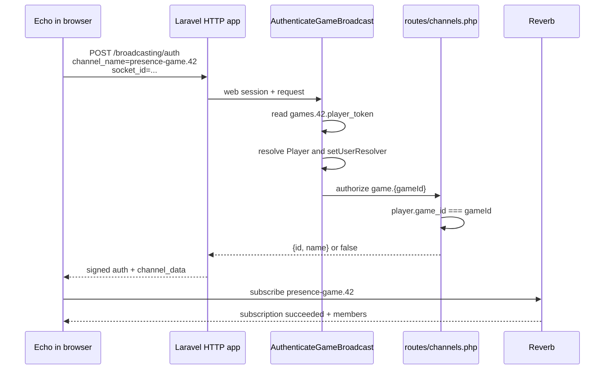
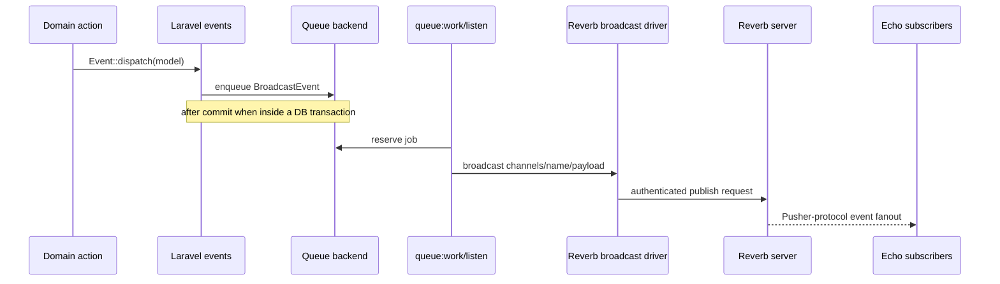
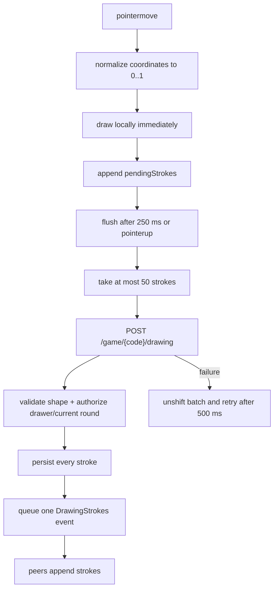

# Implementation walkthroughs

These walkthroughs trace the active runtime paths from browser input to persisted state and back to every browser.

## 1. Boot and connection setup

Start at [resources/js/app.ts](../../resources/js/app.ts):

```ts
if (import.meta.env.SSR) {
    configureEcho({ broadcaster: 'null' });
} else {
    configureEcho({ broadcaster: 'reverb' });
}
```

`@laravel/echo-vue` fills in the Reverb defaults from `VITE_REVERB_APP_KEY`, `VITE_REVERB_HOST`, `VITE_REVERB_PORT`, and `VITE_REVERB_SCHEME`. It also supplies `pusher-js` to Laravel Echo.

The null broadcaster during server-side rendering is not a test stub. It prevents the Node SSR process from opening a browser-style WebSocket connection and keeps rendered output deterministic. The browser creates the real connection when the Vue application hydrates.

In [Room.vue](../../resources/js/pages/Games/Room.vue), `useConnectionStatus()` exposes the Echo connection as a reactive status. The UI deliberately reports `connecting` until `onMounted()` to avoid an SSR/hydration mismatch.

Possible values are `connecting`, `connected`, `reconnecting`, `disconnected`, and `failed`.

## 2. Joining the presence channel

The room derives one logical channel name:

```ts
const channelName = `game.${props.game.id}`;
```

Every `useEchoPresence(...)` call shares the same underlying subscription. The Vue adapter reference-counts consumers and leaves the channel when the component unmounts. The separate `presence.channel()` call is used for membership callbacks.

### Authorization sequence



The channel has three related names:

| Context                       | Value              |
| ----------------------------- | ------------------ |
| application/Echo logical name | `game.42`          |
| authorization pattern         | `game.{gameId}`    |
| Pusher-compatible wire name   | `presence-game.42` |

[AuthenticateGameBroadcast.php](../../app/Http/Middleware/AuthenticateGameBroadcast.php) parses the wire name because that is what `/broadcasting/auth` receives. Echo's `useEchoPresence` accepts the logical name and adds the presence prefix internally.

The middleware is attached by [bootstrap/app.php](../../bootstrap/app.php) to the broadcasting authorization route along with the `web` middleware. The web middleware is essential because the guest-player credential lives in the session.

### Membership is connection state, not game state

The callbacks update `onlinePlayerIds`:

- `here` replaces it with the subscription roster;
- `joining` adds one ID;
- `leaving` removes one ID.

This does not add or delete a `Player` record. Closing a tab changes presence membership but does not mean the player explicitly left the game. Conversely, the `PlayerJoined` and `PlayerLeft` domain events change the persistent lobby roster and trigger a snapshot refresh.

## 3. What Laravel does with a broadcast event

The active events follow a common shape:

```php
class PlayerJoined implements ShouldBroadcast, ShouldDispatchAfterCommit
{
    use Dispatchable, InteractsWithSockets, SerializesModels;

    public function broadcastOn(): array
    {
        return [new PresenceChannel("game.{$this->player->game_id}")];
    }

    public function broadcastAs(): string
    {
        return 'PlayerJoined';
    }

    public function broadcastWith(): array
    {
        return ['player' => /* explicit public fields */];
    }
}
```

Each part answers a different question:

| Part                        | Question answered                                                     |
| --------------------------- | --------------------------------------------------------------------- |
| `ShouldBroadcast`           | should Laravel enqueue a broadcast job?                               |
| `ShouldDispatchAfterCommit` | if dispatched inside a transaction, when may that job become visible? |
| `SerializesModels`          | how should Eloquent models cross the queue boundary?                  |
| `broadcastOn()`             | which clients may receive it?                                         |
| `broadcastAs()`             | what stable client event name is published?                           |
| `broadcastWith()`           | exactly which data crosses the trust boundary?                        |

Because the events define `broadcastAs()`, Echo listeners use a leading dot:

```ts
useEchoPresence(channelName, '.PlayerJoined', callback);
```

Without the dot, Echo applies its default `App.Events` namespace and listens for a different name.

### Queued delivery path



The application does not use `toOthers()`. Instead, it handles the sender explicitly:

- guesses are added from the HTTP response and deduplicated by message ID when Echo delivers the same fact;
- drawing strokes render immediately and incoming strokes with the current `player_id` are ignored;
- clearing an already-cleared canvas is idempotent.

This avoids depending on an `X-Socket-ID` header in the standalone Inertia `useHttp` requests.

## 4. Drawing: optimize locally, persist in batches

Drawing is the highest-frequency path. Follow it through [DrawingCanvas.vue](../../resources/js/components/game/DrawingCanvas.vue), [DrawingController.php](../../app/Http/Controllers/DrawingController.php), [RecordDrawing.php](../../app/Actions/Games/RecordDrawing.php), and [DrawingStrokes.php](../../app/Events/DrawingStrokes.php).



### Why coordinates are normalized

The browser stores `0..1` coordinates rather than pixels. Each recipient multiplies them by its own canvas dimensions. The same drawing therefore scales across viewport sizes and device pixel ratios.

### Why render before sending

Pointer input feels wrong if it waits for an HTTP request, a database insert, a queue worker, Reverb, and Echo. Local drawing removes that latency from the user interaction.

### Why batch

A raw pointer stream can emit hundreds of segments. The component:

- waits up to 250 ms;
- submits at most 50 segments per request;
- persists the whole batch;
- queues one `DrawingStrokes` broadcast for the batch.

The server request validator also caps the batch at 50. That keeps browser and server assumptions aligned and avoids one queued job per line segment.

### Why persist before broadcasting

Persistence enables:

- a player joining or reconnecting to reconstruct the canvas from `GameSnapshot`;
- the periodic reconciliation request to repair dropped events;
- server-side validation of who drew what and in which round;
- clearing only the active round's stored canvas.

### Failure and stale-write behavior

Failed batches are put back at the front of `pendingStrokes` and retried. Every batch includes `round_id`; if a retry arrives after the next round starts, `RecordDrawing` rejects it with `409` rather than contaminating the new canvas.

On the receiving side, `Room.vue` also ignores a batch whose `round_id` is not the current round. The server check protects canonical state; the client check protects the projection from late delivery.

## 5. Guessing: transaction, response, and broadcast

Follow [Room.vue](../../resources/js/pages/Games/Room.vue), [GuessController.php](../../app/Http/Controllers/GuessController.php), [SubmitGuess.php](../../app/Actions/Games/SubmitGuess.php), [ChatMessage.php](../../app/Events/ChatMessage.php), and [CorrectGuess.php](../../app/Events/CorrectGuess.php).

### Server transaction

`SubmitGuess` locks the game, round, and player. It then verifies:

- the game is playing;
- the request targets the current round;
- the drawer is not guessing;
- the round has not ended;
- the player has not already guessed correctly.

The normalized guess is compared to the word. A correct guess creates the guess record and increments both guesser and drawer scores inside the same transaction.

### Two outputs from one command

The action returns an HTTP representation to the sender and dispatches a broadcast representation to the room:

- incorrect guess -> `ChatMessage`;
- correct guess -> `CorrectGuess` with points and updated player score.

The correct-answer event intentionally replaces the submitted text with `guessed correctly!`. Its `broadcastWith()` output never contains the secret word. A feature test enforces this.

### Sender/peer convergence

The sender adds the message from the HTTP response. When its own queued event arrives later, `addMessage()` discards a duplicate ID. For a correct answer, every client also requests a snapshot so scores and any resulting lifecycle transition are refreshed from canonical state.

If all eligible guessers are correct, the same request invokes `FinishRound`. That can enqueue several events in quick succession (`CorrectGuess`, `RoundEnded`, then `RoundStarted` or `GameFinished`). The UI treats those events as refresh triggers rather than attempting to reproduce all domain transitions locally.

## 6. Round lifecycle: delayed jobs plus idempotency

Follow [StartRound.php](../../app/Actions/Games/StartRound.php), [EndRound.php](../../app/Jobs/EndRound.php), and [FinishRound.php](../../app/Actions/Games/FinishRound.php).

When a round starts:

1. the server chooses a drawer and word;
2. it persists `started_at` and `ends_at`;
3. it dispatches `RoundStarted`;
4. it schedules a unique `EndRound` job for `ends_at` using `afterCommit()`.

The browser's countdown is display state calculated from the server timestamp. It does not end the round.

`EndRound` may be retried or may race with the “everyone guessed” path. `FinishRound` therefore locks the round and game and exits when the round is already ended, the game is no longer playing, or the game's current round has changed. This makes duplicate and stale jobs harmless.

After the transaction commits, it publishes `RoundEnded`, then either:

- marks the game finished and publishes `GameFinished`; or
- creates the next round and publishes `RoundStarted`.

## 7. Snapshot reconciliation

[GameSnapshot.php](../../app/Actions/Games/GameSnapshot.php) is the client projection boundary. It shapes:

- public game/player data;
- player-specific word visibility;
- the active round;
- all persisted strokes for that round;
- flattened chat history;
- masked word data for non-drawers.

The snapshot is returned by:

- the initial Inertia room response;
- `GET /game/{game}/state`;
- the start-game command response.

`Room.vue` refreshes it after coarse-grained lifecycle events, after correct guesses, and every 15 seconds. `stateRequest.processing` prevents overlapping refreshes. If an event occurs during an in-flight refresh and no new request starts, the periodic timer is the final repair mechanism.

This design avoids requiring every event payload to contain an entire game. Fine-grained, frequent drawing/chat events update locally; coarse domain changes invalidate and reload the projection.

## 8. Event taxonomy

The active events fall into two frontend strategies:

| Strategy            | Events                                                                                    | Client behavior                                     |
| ------------------- | ----------------------------------------------------------------------------------------- | --------------------------------------------------- |
| apply payload       | `ChatMessage`, `DrawingStrokes`, `CanvasCleared`                                          | mutate a small local collection directly            |
| invalidate snapshot | `PlayerJoined`, `PlayerLeft`, `GameStarted`, `RoundStarted`, `RoundEnded`, `GameFinished` | call `refreshState()`                               |
| apply + invalidate  | `CorrectGuess`                                                                            | add its chat message, then refresh scores/lifecycle |

This is similar to a client cache: some events are patches; others are invalidation signals.

Next: [Reference and labs](reference-and-labs.md).
